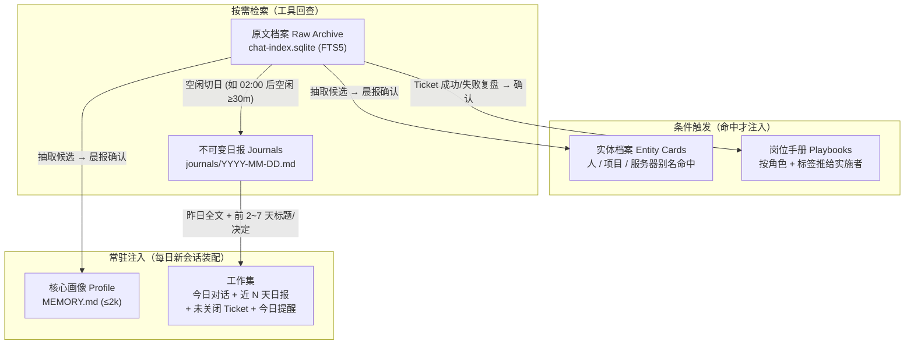
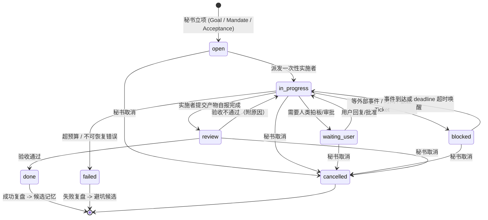
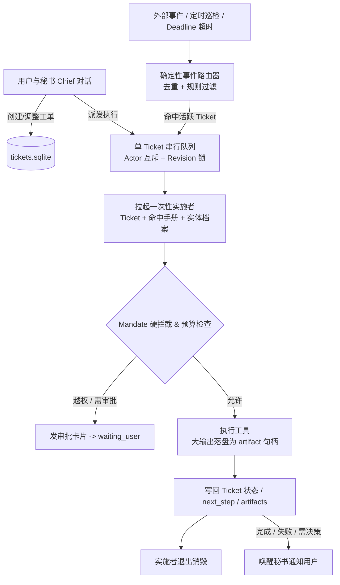

# 项目总说明书、目标架构与设计抉择

> 本文档是 `dsh-ctrl` 的长期指引文档，记录**项目定位、关于记忆/上下文/任务三大系统的核心思考与最终拍板、目标架构图、设计抉择（ADR）以及分期落地顺序**。后续开新 Issue 或调整方向时，均以本文档为基准对照。

---

## 一、项目终极目标与角色定位

打造一个**像真人秘书一样能持续跟进事务、无需手动切换会话、拥有清晰记忆、能主动提醒和安排工作**的个人助理 Agent：

- **角色收敛（先双角色，后加工作群）**：
  1. **秘书（`Chief`，主 Bot）**：唯一面向你的日常交互窗口——听你交代事情、记账、安排任务、做日结与晨报、跟进提醒，**不亲自干耗时的脏活累活**。
  2. **实施者（`Worker`）**：负责真正动手执行具体任务（写代码、搜资料、改配置、查日志），干完交回结果即退出，不污染秘书上下文。
  3. **工作群（远期追加）**：等多角色单主干跑顺后，再按需引入多员工协作群聊。
- **开发策略**：App 只是交互与同步窗口；优先在 Windows 本地把 `ds-bot` 后端插件打磨扎实，且**每次只专注攻克一个子系统（先独立做好按日期的记忆系统）**，避免多个系统混在一起带来思想负担。

---

## 二、关于记忆系统的思考：应该想起什么？

### 1. 核心思考：秘书到底应该记住哪些东西？
1. **身份与偏好（个人档案）**：你是谁、做事风格、沟通偏好（例如“先说结论再说过程”）、固定环境信息。
2. **历史与决策（发生过什么）**：之前发生的事情、做过的决定、关键思考过程与结论。
3. **补充的三块关键拼图（仅靠“档案 + 时间”记不住的内容）**：
   - **实体档案（Entity Cards）**：人、项目、客户、服务器、常用工具的稳定事实——提到名字或别名就应该立刻想起，不能因为过了 7 天就忘掉。
   - **经验与避坑手册（Playbooks / Lessons）**：尤其是**你纠正过的地方**（“不对/别这样/我说过…”）和**任务失败踩过的坑**，供实施者在干同类活时避坑。
   - **时效与准入边界（防记忆越攒越脏）**：有时效的信息要能自动过期；模型自动抽取的记忆不能直接永久生效，必须先进入候选池，经用户确认或多次印证后再晋升常驻。

> **核心边界**：**任务进度不是记忆**。“做到哪了、卡在谁”永远归任务系统（Ticket）管；记忆系统只管“人、事、偏好、经验、过去发生了什么”。

### 2. 六条设计原则
1. **原文不可变，其余皆派生**：所有原始消息、工具输出、事件只追加不修改；日报、画像、档案都是派生品，坏了可以随时重建。
2. **按“怎么被取出来”分层**：常驻注入 / 条件触发 / 按需检索，三种取法决定三类存储。
3. **写入宽松，晋升严格**：候选记忆可以宽松记录，进入常驻层必须经确认（如晨报确认）或多次印证。
4. **每条记忆有出处和时间**：带原文锚点；新事实**取代（supersede）**旧事实并保留历史，而不是直接覆盖。
5. **确定性召回优先，语义检索兜底**：按状态、实体别名、日期、标签精确拉取，比指望模型自己想起来去搜可靠得多。
6. **每层有 Token 预算，避免“摘要的摘要”**：绝不滚动重写周摘要（防止传话游戏失真），超预算按规则降级。

### 3. 最终拍板方案：按“日期 + 空闲切日”的分层记忆

| 取法层级 | 包含内容 | 对应“1 / 7 / 长期”直觉 | 存储与生命周期 |
|---|---|---|---|
| **常驻注入**（每轮/每日开场带入） | **核心画像**（身份/偏好/规矩）+ **近 N 天日报**（昨天全文，前 2~7 天只取标题与决定） | **长期** + **1 天 / 7 天**（窗口天数可调） | `MEMORY.md`（≤2k tokens）+ `journals/YYYY-MM-DD.md`（每日一份，生成后不可变） |
| **条件触发**（命中才注入） | **实体档案**（人/项目/服务器）+ **岗位手册**（避坑经验） | 跨时间稳定召回 | Markdown 卡片 / `[[topic]]` + 标签/别名精确匹配 |
| **按需检索**（工具调用） | **原文档案** + 全部历史日报 | 跨月/跨年精确回查 | 沿用 `ds-bot` 现有 `chat-index.sqlite`（FTS5）+ 原文锚点 |

- **跨天重置与空闲切日策略（核心创新）**：
  - 不在零点硬切打断深夜对话，而是**按空闲状态区分“昨天”与“今天”**——例如：**过了凌晨 `02:00` 且连续空闲超过 30 分钟**（可配置），后台自动触发“昨日记忆日结”：
    1. 扫描昨日原文，派生一份结构化不可变日报 `journals/YYYY-MM-DD.md`（包含：发生了什么、做出的决定、新建/变更的 Ticket、**你纠正过我的地方**、悬而未决的问题、提到的实体）；
    2. 将新抽取的偏好/教训写入 `candidate` 候选池（次日晨报向你确认后才晋升常驻）；
    3. 秘书自动切换到干净的新一天会话（当天内若聊得太长超水位，照常 `compact` 兜底）。
- **为什么这样彻底解决了“跨月对话变傻”**：秘书每天都以一张干净、低 Token、高信噪比的桌子上班，彻底告别无限拉长一条 Session 带来的上下文腐烂。

---

## 三、关于上下文的思考：现在要干什么？

### 1. 核心思考：这一刻推理需要看什么？
1. **历史记忆与部分历史上下文**：长期画像、近 N 天日报、刚刚聊过的相关上下文。
2. **任务列表**：当前未关闭的活跃 Ticket、今日到期提醒。
3. **正在发生和讨论的事情**：当下这一轮的真实对话、刚提到的实体档案与必要工具反馈。

### 2. 最终拍板方案：双轨上下文装配 + 大输出落盘

- **为什么不能对秘书做“每步重建”**：如果秘书每轮都重写前面的 prompt，会打碎模型 Prompt Prefix Cache（成本和延迟暴涨 5~10 倍）并丢失实时聊天连贯性。
- **最终双轨策略**：
  1. **秘书（面向人，保连贯 & 吃缓存）**：
     - 每天开启新会话时按固定顺序与预算装配：
       1. 系统规则 + 核心画像 `MEMORY.md`（冻结前缀，≤2k）
       2. 未关闭 Ticket 摘要 + 今日到期提醒（按状态拉取，≤2k）
       3. 近期高频/刚提到的实体档案（别名命中，≤2k）
       4. 近 N 天日报（昨天全文 + 更早仅标题与决定，≤3k）
       5. 今日实时对话（原文；当天内超限走 `compact` 兜底，绝不塞海量工具日志）
     - 需要查更早细节时，调 `read_own_chat` / `recall` 按需回查原文锚点。
  2. **实施者（面向任务，每次唤醒干净重建）**：
     - 不带秘书的闲聊历史；每次唤醒只装配：**Mandate + Ticket 状态 + 按标签命中的岗位避坑手册 + 相关实体档案 + 上次产物句柄**。
     - 单次执行内吃满缓存，跑完写回 Ticket 即销毁退出。
  3. **抗噪声底线（工具大输出落盘）**：
     - 超过阈值的命令日志、文件内容、网页抓取直接落盘，上下文中仅保留简短摘要与句柄（如 `artifact://...`），需要时按需翻页读取。

---

## 四、关于任务系统的思考：怎么设计这个任务系统？

### 1. 核心四个问题的思考与拍板

| 问题 | 思考要点 | 最终拍板方案 |
|---|---|---|
| **如何记录** | 不能靠模型记忆或零散聊天记录追踪，重启和换天都不能丢 | 独立 SQLite 账本 `<home>/tickets.sqlite`（已于 Issue #3 落地）：记录 `goal`、`mandate`（授权边界）、`acceptance`（验收标准）、`status`、`owner`、`next_step`、`waiting_on`、`wake_condition`、`deadline`、`blockers`、`artifacts` 与 `revision` 乐观锁 |
| **如何实施** | 长期存活的 Worker 会话迟早膨胀变傻；且并发修改会冲突 | **Ticket 长期持久，实施者用完即弃**：每个 Ticket 配一条串行事件队列（Actor 互斥 + `revision` 防覆盖）；每次拉起干净的实施者推进当前阶段，结果与失败原因写回 Ticket 后立即退出；高风险操作由 `tools/pre-execute` 按 Mandate 硬拦截 |
| **如何验收** | 实施者自报完成不可靠，且不是所有标准都能靠代码判断 | **分层验收**：① 机器可判定（测试/文件/接口状态码）→ 脚本核对；② 主观质量判断 → 独立干净会话评审；③ 业务/高风险决策 → Ticket 进入 `waiting_user` 等你拍板 |
| **如何通知** | 不能事无巨细刷屏，也不能静默卡死 | **静默执行 + 关键节点通知**：日常推进不打扰你；仅在 **完成 / 失败 / 超预算 / 需要审批（`waiting_user`）/ Deadline 超时** 时唤醒秘书，通过对话消息、`show_view` 交互卡片或 `notice` 推送给你；日常早间通过**晨报**集中汇报待办与记忆确认 |
| **如何完善事件体系** | 外部事件和定时提醒如果直接全量灌给模型，会制造大量噪声 | **确定性事件路由 + 显式订阅**：Ticket 显式声明 `waiting_on`、`wake_condition`、`deadline`；外部事件/定时巡检/超时信号先由确定性代码去重过滤，命中活跃 Ticket 后直接进入该 Ticket 串行队列唤醒实施者，未命中或需人类拍板的才交秘书 |

---

## 五、目标架构图（三条生命周期解耦）

### 1. 记忆分层与空闲日结流程

### 2. Ticket 生命周期状态机

### 3. 实施者单次运行与事件驱动循环

---

## 六、关键架构抉择汇总（ADR）

1. **ADR-1（底座选择）**：以 `ds-bot` 为底座嫁接 DeepSeek Super-agent 与 OpenDot 的核心机制，不从零重写，也不直接拿 POSIX 强耦合的原型当底座。
2. **ADR-2（防跨月退化）**：采用**秘书每日空闲切日重置 + 不可变日报拼接 + 实施者用完即弃**，从根源消除跨月上下文腐烂，同时在单日/单次运行内保持前缀稳定吃满 Prefix Cache。
3. **ADR-3（单点突破，拒绝混做）**：先独立做好**按日期的记忆系统（M1）**，再做实施者闭环，最后再做工作群与复杂事件接入，降低开发与认知负担。
4. **ADR-4（记忆防污染）**：候选池 + 晨报确认 + 纠正/失败双驱动写入 + 取代而非覆盖 + 原文锚点回查。
5. **ADR-5（防越权与防假完成）**：Mandate 落到 `tools/pre-execute` 工具层硬拦截，验收区分机器/独立评审/人类审批。

---

## 七、分期落地路线图（按减负优先级排序）

| 阶段 | 模块 | 核心交付 | 状态 |
|---|---|---|---|
| **Phase 0** | 本地基线 | Windows 本地开发与单测环境（`dsh@0.2.2-rc.5` + `bot-dev` `link:` 挂载） | ✅ 已完成 |
| **Phase 1** | 任务底座（[`#3`](https://github.com/5quan/dsh-ctrl/issues/3)） | `tickets.sqlite` v2 状态机 + 4 个工单工具 + 权限隐私隔离 + 换段摘要注入 | ✅ 开发测通（`feat/3-tickets` 待合并） |
| **Phase 2（当前优先）** | **按日期记忆系统（M1）** | **空闲切日判定**（如 `02:00` 后空闲 ≥30m）+ **日终不可变日报** `journals/YYYY-MM-DD.md` + **新一天会话自动拼接近 N 天日报 + 活跃 Ticket** | ⏳ 下一期立刻启动 |
| **Phase 3** | 记忆进阶（M2–M3） | 实体档案别名触发、候选记忆池、用户纠正检测与晨报一键确认 | ⏳ 规划中 |
| **Phase 4** | 实施者闭环 | 一次性实施者派发、工具大输出落盘句柄、单 Ticket 串行队列、Mandate 硬拦截 | ⏳ 规划中 |
| **Phase 5** | 事件体系与维护 | Deadline 超时唤醒、外部事件路由、岗位避坑手册（失败复盘）、周维护与记忆回归评估 | ⏳ 规划中 |
| **Phase 6** | 扩展形态 | 追加工作群、Cloudflare 隧道（家机部署）、精简 App 插件化 | ⏳ 远期 |
