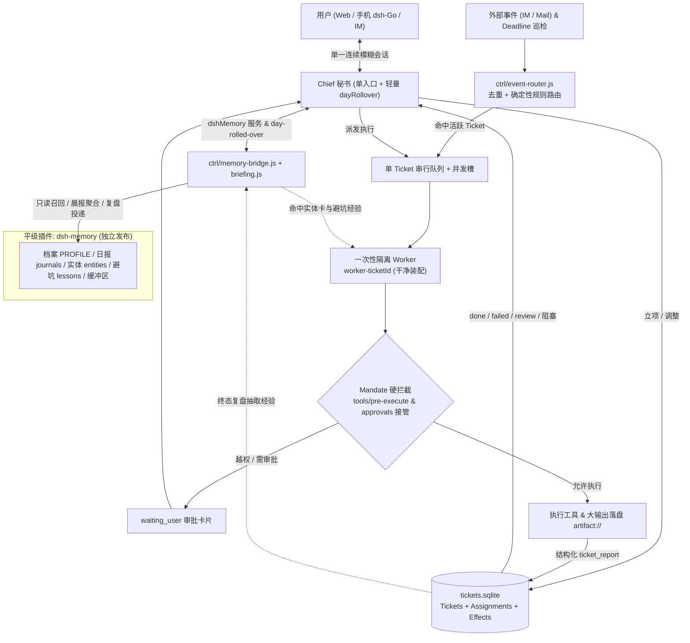

# 项目总说明书、目标架构与设计抉择

> 本文档是 `dsh-ctrl` 的长期指引文档，记录**三层平级拓扑、记忆与避坑边界、模糊会话机制、任务与一次性 Worker 编排、设计抉择（ADR）以及分期落地顺序**。后续开新 Issue 或调整方向时，均以本文档为基准对照。

---

## 一、三层平级拓扑与角色定位

### 1. 三层平级结构（单向依赖，独立发布）

`dsh-memory` 与 `dsh-ctrl`（定制 `ds-bot`）并非父子关系，而是**平级挂载在同一个 DSH（Cordis 插件总线）上的两个独立插件**：

```text
                ┌──────────────────────────────────────┐
                │        DSH Core (Cordis 运行时)       │
                │  session/event · systemPrompt ·      │
                │  agent/pre-step · tools · llm        │
                └──────────┬──────────────────┬────────┘
                           │                  │
            ┌──────────────▼───┐          ┌───▼──────────────────────────┐
            │    dsh-memory    │◄─────────┤     dsh-ctrl (定制 ds-bot)   │
            │  独立记忆插件     │  单向消费 │ 模糊会话 · Ticket · Worker   │
            │  (记忆 + 避坑)   │  服务与事件│ Mandate 拦截 · 事件路由 · UI │
            └──────────────────┘          └──────────────────────────────┘
```

- **`dsh-memory`（记忆与避坑底座）**：保持零 `ds-bot` 依赖，可在原版 DSH 开箱独立运行；对外仅暴露公开 Cordis 服务 `dshMemory`（`contractVersion: 1`）与标准事件 `dsh-memory/day-rolled-over`。
- **`dsh-ctrl`（本仓库，助理外壳与编排引擎）**：默认在 Profile 中关闭 `ds-bot` 原生 `memory: false`（同步关闭 `learning.js`），主动绑定并单向消费 `dshMemory` 服务与日结事件。

### 2. 核心角色收敛（先双角色，后按需扩展工作群）

1. **秘书（`Chief`，主 Bot）**：唯一面向用户的长期交互窗口——听交代、立项建单、发晨报、做关键汇报与审批确认，**不亲自干耗时脏活累活**。
2. **实施者（`Worker`，一次性执行单元）**：面向单条 Ticket 拉起的隔离临时 Session，按 Mandate 与验收标准动手改代码/查资料/跑命令，写回 `artifacts` 与结构化报告后即销毁，不污染 `Chief` 上下文。
3. **工作群（远期 Phase 5 按需启用）**：上游 `ds-bot` 自带的 `roster / groups / goals` 暂冻结不动，待单主干跑稳后再决定启用或裁剪。

---

## 二、记忆与避坑边界（外置 `dsh-memory`，零重复建设）

### 1. 明确边界划分

| 归属领域 | 负责方 | 说明 |
|---|---|---|
| **记忆系统与避坑经验** | **`5quan/dsh-memory`**（M1–M5 已完成） | 统一承担：原文归档（`archive.sqlite` + FTS5）、时间轴不可变日报（`journals/`）、核心画像（`PROFILE.md`）、实体档案（`entities/`）、**程序性避坑经验 / 教训卡片（`lessons/` / Playbooks）**、OpenViking 历史总览（L0/L1/L2）、统一缓冲区与晨报汇总（`buffer/` + `briefing`）、自动纠偏捕获（`correction`）以及 M4 Dream 后台自维护与回滚。 |
| **可执行技能与工具挂载** | **DSH / `dsh-ctrl` 执行层** | 工具声明、MCP 挂载、`capabilities` / `SKILL.md` 能力配置属于执行手脚，留在本仓执行层管理。 |
| **原生旧记忆与旧学习轮询** | **静音（后期删除）** | 通过 Profile 配置 `memory: false`（自动同时关闭 `ds-bot` 原生 `memory*.js` 与 `learning.js`），避免双记忆前缀、双确认卡片与重复烧 Token。 |

> **核心铁律**：**任务进度不进记忆**。“做到哪了、卡在谁、截止日期、授权范围”永远归 `dsh-ctrl` 的 `tickets.sqlite` 管；“人、事、偏好、历史决定、实体档案、踩过的坑”永远归 `dsh-memory` 管。

### 2. `dsh-ctrl` 对接契约（规划 `ctrl/memory-bridge.js`）

- 订阅 `dsh-memory/day-rolled-over`：驱动 `Chief` 在空闲时无缝执行轻量日结换段；
- 消费 `dshMemory.getMorningBriefing()` / `confirmBufferItems()` / `markBriefingDelivered()`：将记忆待确认项与到期/待审 Ticket 合并成**单张交互晨报卡片**，并通知 `dsh-memory` 已投递避免当日双推；
- 消费 `dshMemory.matchEntities()` 与 `dshMemory.matchLessons()`：为一次性 Worker 精准装配相关实体卡与历史避坑约束；
- Ticket 终态复盘反哺：工单进入 `done` / `failed` 时，抽取避坑教训或新环境事实调用 `dshMemory.submitBufferCandidate(...)` 投递进缓冲区等待确认。

---

## 三、模糊会话概念（Blurred Session：单窗口永续对话流）

用户视角中**永远只有 `Chief` 这一个不断线的聊天窗口**，没有“手动开新会话”“上下文满了自己重开”的概念：

- **底层无缝换段（`parts.js`）**：按上下文压力（Checkpoint / 换 Part）、工作目录切换、溢出抢救或**空闲切日**静默切换底层 DSH Session，未处理消息自动转发，定时任务自动随新 Part 迁移，用户侧历史可无缝上翻读取旧 Part。
- **日结轻量换段（`dayRollover` 陷阱规避）**：原版 `rt.newPart()` 会调 LLM 生成 8 段式交接笔记并搬运最多 16k tokens 的旧对话。接入 `dsh-memory` 后，冻结前缀已自动注入 `PROFILE.md + 昨日完整日报 + 近 N 天精华`，因此日结换段必须走**轻量 `dayRollover` 模式**——跳过 `writeNote` 与昨日原文重复搬运，仅携带 `## Active tickets` 与当前活跃态摘要，新一天零噪声上岗。
- **抗噪声底线（`artifact://` 大输出落盘）**：超过阈值的命令日志、文件内容、网页抓取自动落盘为本地文件句柄（`ctrl/artifacts.js`），对话上下文中只保留简短摘要与 `artifact://` 句柄，防止单日对话被海量日志撑爆。

---

## 四、任务编排、一次性 Worker 与事件通知（参考 DeepSeek Super-agent）

结合 DeepSeek Super-agent 设计探索（`dsh-superagent-prototype`）与本仓已落地的 `tickets.sqlite`，任务与编排遵循以下工程模型：

| 问题 | 设计拍板（融合 `dsh-superagent` 原则） |
|---|---|
| **第一原则：省人类注意力** | Worker 执行全程**静默**，不把中间过程刷进 `Chief` 对话流；只在 **完成（`done`）/ 失败（`failed`）/ 需要决策（`waiting_user`）/ 等待验收（`review`）/ 超时** 时打扰人；每次需拍板尽量以**单张结构化交互卡片（`show_view` / `ask_user`）**呈现，不把问题埋在长报告里。 |
| **如何记录：`Ticket` vs `Assignment`** | 1. **`Ticket`（已于 `#3` 落地 `tickets.sqlite` v2）**：持久化业务工单（`goal`、`mandate`、`acceptance`、`status`、`waiting_on`、`wake_condition`、`deadline`、`artifacts`、`revision` 乐观锁）；<br>2. **`Assignment` + `Effects`（待落地）**：把长期工单与**单次派工（`pending → running → ended`）**拆开；派工、回调、通知遵循 **Stored Work（先落库，事务提交后再执行，带退避重试与重启恢复）**，解决进程重启丢队列与半截状态问题。 |
| **如何执行：隔离一次性 Worker** | 为单条 Ticket 配**串行队列（Actor 互斥 + `revision` 校验）**与全局**并发槽**（额外预留 1 个**人类优先槽**防止后台任务堵死人机对话）；每次通过 `ctx.sessionController.create` 拉起隔离临时 Session（`worker-<ticketId>`，**不写入 `state.bots` 污染侧栏名册**，并带子会话标识使 `dsh-memory` 的 `subagentPolicy: 'user-only'` 自动过滤其工具噪声），干净装配 `Ticket + Mandate + Acceptance + 命中的实体/避坑卡片 + artifact 句柄`，执行完毕由结构化 `ticket_report` 工具写回结果后销毁（**严禁从自由文本推断 `waiting_user`**）。 |
| **如何防越权与防卡死** | 1. **`tools/pre-execute` Mandate 硬拦截（`ctrl/mandate-guard.js`）**：按结构化授权边界拦截高风险/越权工具调用，触发时强制转 `waiting_user`；<br>2. **隐藏 Worker 审批接管**：扩展 `approvals.js` 拦截 `worker-<ticketId>` 的 `approval/request` 并转发到 `Chief` / 手机通知，避免隐藏 Session 弹框无人可见而永久挂死；<br>3. **步数与费用熔断**：单次 Assignment 设步数/Token 上限，并按 Ticket 归因统计用量。 |
| **如何验收** | **分层验收**：① 机器可判定（测试/命令/文件存在）→ 自动校验；② 主观质量 → 独立干净评审；③ 业务/高风险拍板 → `waiting_user` / `review` 卡片交人确认。 |
| **如何驱动外部事件** | 借鉴 `Source → Trigger → Gate → Ticket`：**确定性事件路由器（`ctrl/event-router.js`）**对 IM/邮件/定时巡检/Deadline 超时（`tickets.listDue()`）先做代码去重与规则过滤，命中活跃 Ticket 的 `wake_condition` 直接投递该 Ticket 串行队列推进，仅未命中或需要人类拍板的交 `Chief`。 |

---

## 五、目标架构与核心数据流



---

## 六、关键架构抉择汇总（ADR）

1. **ADR-1（底座选择）**：以 `ds-bot` 为外壳底座（复用其 Part 引擎、审批通道、Web/App/IM/浏览器/邮箱/本地 Agent 设施），严禁修改 `node_modules/@deepseek-ai/dsh` 核心源码。
2. **ADR-2（单向依赖与外置记忆）**：记忆系统与避坑经验统一放在平级独立插件 `dsh-memory`；`dsh-ctrl` 通过 `dshMemory` 服务与 `dsh-memory/day-rolled-over` 单向消费，`dsh-memory` 永不反向引入 `ds-bot`。
3. **ADR-3（模糊会话保缓存）**：单日内通过冻结前缀 + 增量注入保住 Prompt Prefix Cache；跨日由空闲日结事件驱动轻量 `dayRollover` 换段，既消除跨月上下文腐烂，又避免重做 LLM 交接摘要。
4. **ADR-4（Worker 用完即弃与持久队列）**：Ticket 长期持久、Assignment 与 Worker 临时隔离；副作用先写库再执行（Stored Work），严格通过结构化工具报告状态，不为自然语言猜测状态机。
5. **ADR-5（硬授权与低打扰通知）**：高风险操作在 `tools/pre-execute` 硬拦截、隐藏 Worker 审批由宿主接管；执行过程默认静默，仅在完成/失败/需决策时用结构化卡片唤醒 `Chief`。
6. **ADR-6（先隔离、后精简）**：上游 `ds-bot` 模块（如群聊 `roomOf`）横跨近 30 个文件，过早强删会陷入大面积重构泥潭。因此先将所有自研代码集中隔离在 `ds-bot/src/host/ctrl/`（与 `test/ctrl/`、`client/ctrl/`），上游文件仅保留极薄钩子并用配置静音（`memory: false`），待核心秘书与 Worker 闭环跑稳后，再按实测使用清单一次性精准删除无用上游模块。

---

## 七、分期落地路线图

> 详细逐项拆解与验收标准见 [ROADMAP.md](ROADMAP.md)。

| 阶段 | 模块 | 核心交付 | 状态 |
|---|---|---|---|
| **Phase 0** | 本地基线 | Windows 本地开发与单测环境（`dsh@0.2.2-rc.5` + `bot-dev` `link:` 挂载） | ✅ 已完成 |
| **Phase 1** | 任务底座 & 隔离整理（[`#3`](https://github.com/5quan/dsh-ctrl/issues/3)） | `tickets.sqlite` v2 状态机 + 4 个工单工具 + 换段摘要注入；`ctrl/` 目录隔离与文档/`deploy/` 校准 | ✅ 已完成 |
| **外部平级** | **`dsh-memory`（M1–M5）** | 原文归档、空闲切日不可变日报、缓冲区、OpenViking L0/L1/L2、实体卡、冷启动、晨报、自动纠偏、M4 Dream 整理与回滚、M5 避坑经验 `lessons/`（`matchLessons`）及公开 Cordis 服务契约 | ✅ 已在 `5quan/dsh-memory` 完成 |
| **Phase 2（P0）** | **记忆对接与模糊切日** | `ctrl/memory-bridge.js`（事件订阅/实体与避坑召回/终态复盘投递）+ `ctrl/day-rollover.js`（`parts.js` 轻量 `dayRollover` 换段）+ `ctrl/briefing.js`（统一晨报去重卡片） | ✅ 已完成 |
| **Phase 3（当前优先）** | **一次性 Worker 闭环（P1 核心）** | `assignments` + `effects` 持久表、`ctrl/ticket-queue.js`（串行队列+并发槽）、`ctrl/worker-executor.js`（隔离临时 Session + 结构化 `ticket_report` + 分层验收）、`ctrl/artifacts.js`（大输出落盘）、`ctrl/mandate-guard.js`（硬拦截）与 `approvals.js` 隐藏审批接管 | ⏳ 下一期优先启动 |
| **Phase 4** | **主动唤醒与事件路由（P2）** | `ctrl/event-router.js`（确定性去重与规则路由）、`tickets.listDue()` Deadline/卡死巡检、接通邮箱/IM 作为触发源 | ⏳ 规划中 |
| **Phase 5** | **前端整合、大瘦身与常驻部署（P3）** | `client/ctrl/` 改造记忆面板接 `dshMemory` + 极简“待我处理”面板、按 Ticket 归因统计用量、**集中删减确认不用的 `ds-bot` 上游代码**、家机常驻 + Cloudflare Tunnel + `dsh-Go`/IM 接入；按需评估多员工工作群 | ⏳ 远期 |
